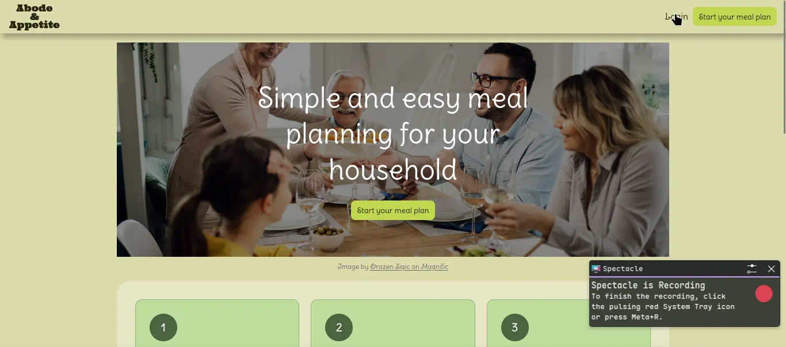
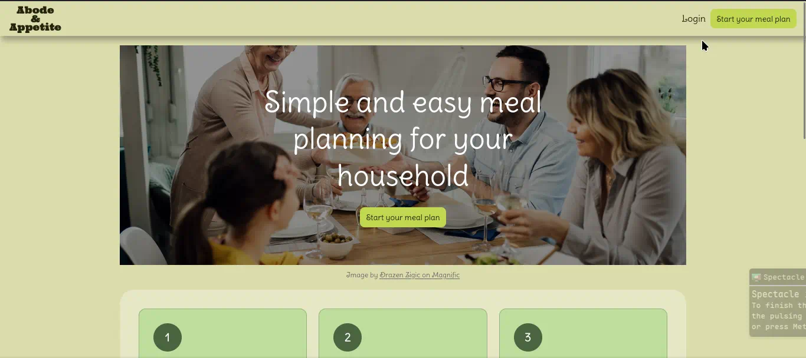

# Sprint 4 - Developing a Refined and Complete System

## Sprint Goals

Develop the system until it is fully featured, with a refined UI and it satisfies the requirements. 
The system will be fully tested at this point.

### Specific Goals

- Refine the design and UI of the website
- Refine the user experience (UX) of the system
- Perform final, full-system testing
- Get user feedback throughout on all of the above

## User feedback

#### floating forms vs separate page forms

"Floating is better"

## Testing Floating HTMX sign up and login forms

Testing the sign up and login forms appearing overlaid over the rest of the page and closing when clicked outside of

Testing the sign up and login forms closing after clicking the cancel button

Can't open another form after cancelling one

### Changes / Improvements

Changed the HTMX to innerHTML so it only replaces the contents of the div instead of the div itself

## Testing FEATURE NAME HERE

Replace this text with notes about what you are testing, how you tested it, and the outcome of the testing

**PLACE SCREENSHOTS AND/OR ANIMATED GIFS OF THE TESTING HERE**

### Changes / Improvements

Replace this text with notes any improvements you made as a result of the testing.

**PLACE SCREENSHOTS AND/OR ANIMATED GIFS OF THE IMPROVED SYSTEM HERE**

## Testing FEATURE NAME HERE

Replace this text with notes about what you are testing, how you tested it, and the outcome of the testing

**PLACE SCREENSHOTS AND/OR ANIMATED GIFS OF THE TESTING HERE**

### Changes / Improvements

Replace this text with notes any improvements you made as a result of the testing.

**PLACE SCREENSHOTS AND/OR ANIMATED GIFS OF THE IMPROVED SYSTEM HERE**

## ETC...

## Sprint Review

Replace this text with a statement about how the sprint has moved the project forward - key success point, any things that didn't go so well, etc.

