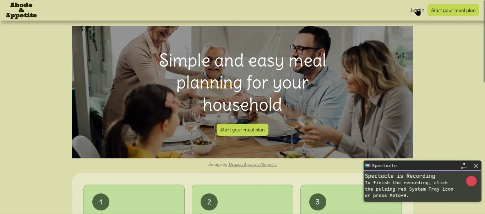
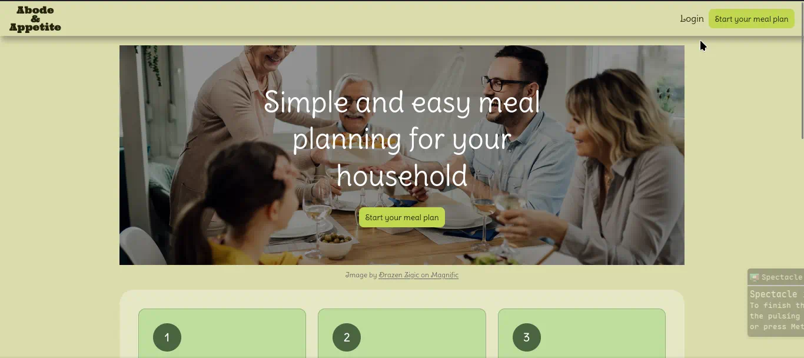
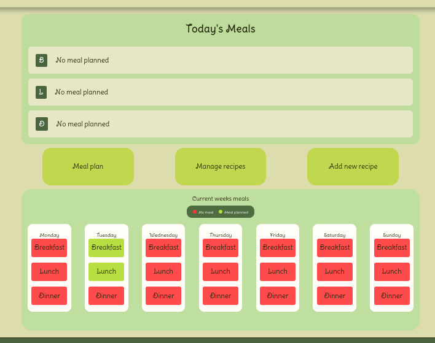
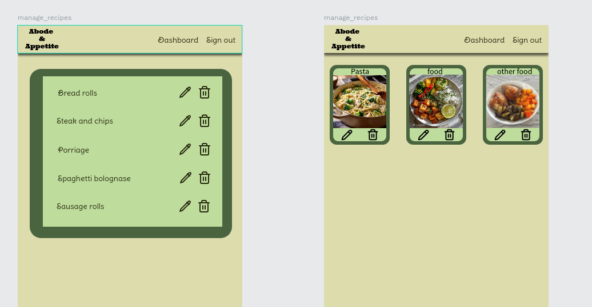
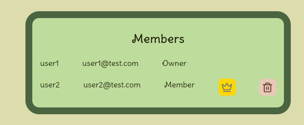
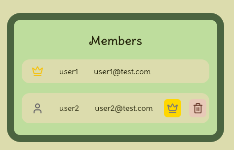
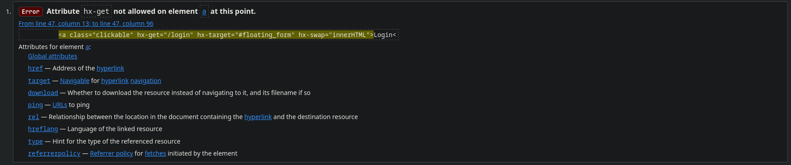

# Sprint 4 - Developing a Refined and Complete System

## Sprint Goals

Develop the system until it is fully featured, with a refined UI and it satisfies the requirements. 
The system will be fully tested at this point.

### Specific Goals

- Refine the design and UI of the website
- Refine the user experience (UX) of the system
- Perform final, full-system testing
- Get user feedback throughout on all of the above

## User feedback

#### floating forms vs separate page forms

"Floating is better"

## Testing Floating HTMX sign up and login forms

Testing the sign up and login forms appearing overlaid over the rest of the page and closing when clicked outside of

Testing the sign up and login forms closing after clicking the cancel button

Can't open another form after cancelling one

### Changes / Improvements

Changed the HTMX to innerHTML so it only replaces the contents of the div instead of the div itself

## Testing Dashboard

Added a dashboard for when the user is logged in. Needs to show fields for joining and creating a household
when user isn't in a household and show household details when they are in a household

## User feedback

Asked end-user what design ideas they had for manage recipes page as it was quite bland in refined ui prototype

Came up with this option here compared to original 

## User feedback

Showed end user progress on manage members section of manage household. Received feedback that it didn't seem quite right
after some ideation came up with a crown or person icon on the left side of the name to designate owner or member

## Validation - 

### Homepage
36 errors and warnings however 24 of these were because the validator doesn't recognise HTMX syntax

For example:

### Dashboard
1 Warning that there is an h2 but no h1 above it, was easily fixed so no errors or warnings for this page

### Meal plan
No errors

### Manage recipes
2 missing alt texts for images, easy to fix so no errors

### Add new recipe
No errors

### Add meal to meal plan
A bunch of errors that were all fixed by fixing the first one which was a missing > on a div tag

## Sprint Review

This sprint was went very well as I've produced an aesthetic and layout that I am very happy
with but because of my very verbose testing in previous sprints I've struggled to find things to test in this sprint

